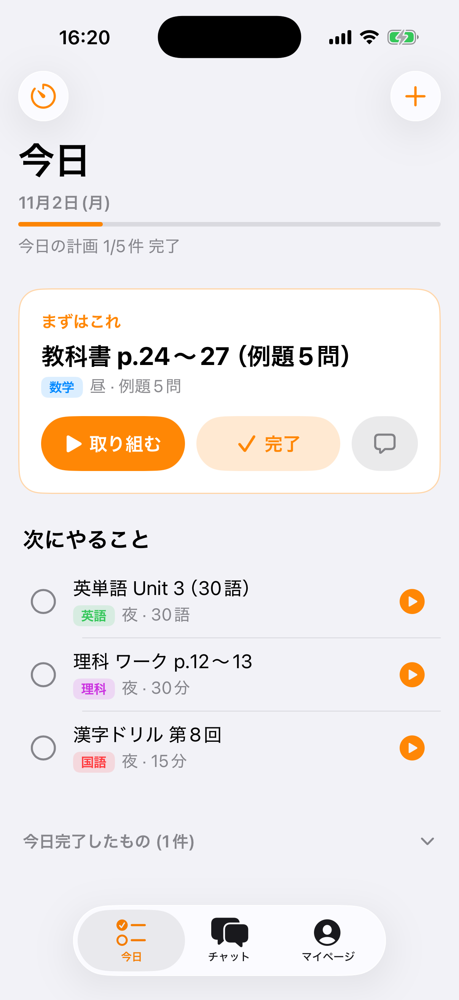
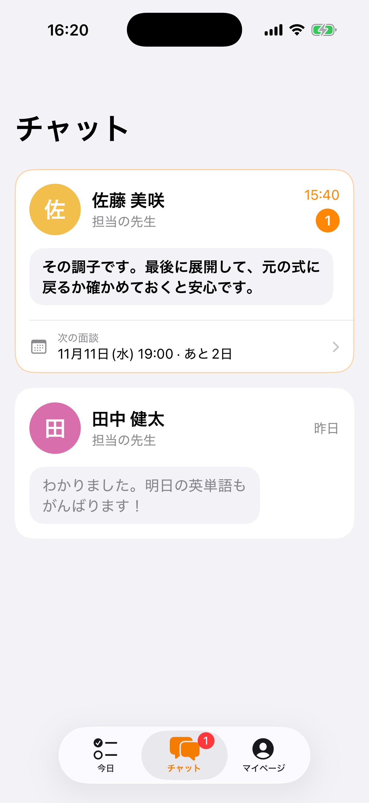
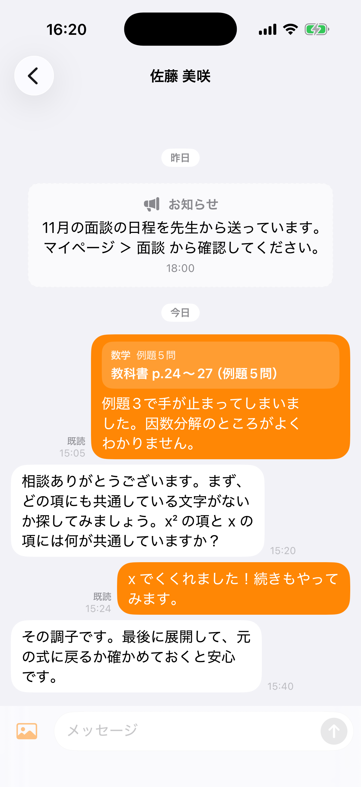

# Nobilva アプリの使い方

先生が立てた計画を確認し、勉強した時間を記録し、わからないことを先生に相談するためのアプリです。
画面の下にある **「今日」「チャット」「マイページ」** の 3 つのタブを切り替えて使います。

---

## はじめに：ログイン

- **初回登録**：契約時に届いたリンクを開き、好きなユーザーID (英数字 3〜24 文字) を決めて登録します。
  **パスキー** (Face ID / Touch ID) での登録がおすすめです。使えない場合はパスワード (8 文字以上) でも登録できます。
- **2 回目以降**：Face ID / Touch ID でそのままログインできます。パスワードでのログインも可能です。
- **ログインできないとき**：ログイン画面の「ログインできない方はこちら」から保護者のメールアドレスを入力すると、ログインし直すためのリンクが届きます。

初めて開いたときは、画面の使い方を順番に紹介する案内が表示されます。
この案内は **マイページ ＞ 使い方** からいつでも見直せます。

---

## 「今日」タブ — 今日やることを確認する

| 表示 | 内容 |
| --- | --- |
| **まずはこれ** | いちばん先に取り組むことが大きく表示されます。遅れている計画があれば、そちらが優先されます。「取り組む」でタイマーを開始し、終わったら「完了」を押します。 |
| **次にやること** | 今日の残りのやることが並びます。 |
| **今日の面談 / 次の面談** | 面談の予定です。時間になったら「面談に参加」から入れます。 |
| **日付が決まっていないタスク** | やる日を決めずに登録したタスクです。 |
| **今日完了したもの** | 今日終えたものの一覧です。 |

**操作のしかた**

- **左の丸をタップ** … 完了にします。取り組んだ時間 (15 分・1 時間など) を選んで記録することもできます。間違えたときは「元に戻す」で戻せます。
- **行をタップ** … タイマーが開き、そのやることに取り組めます。
- **行を長押し** … 先生に相談したり、タスクを編集したりできます。
- **「タスクを追加」** … 宿題や自分で進めたいことを登録できます。科目・やる日・かかる時間・期限・くり返し (毎週○曜など) を設定できます。
- **「タイマーで自習する」** … 計画にないことを勉強するときや、計画を終えたあとの自習の時間を記録できます。

---

## タイマー — 勉強時間を記録する

3 つのモードから選べます。

| モード | 使い方 |
| --- | --- |
| **ポモドーロ** | 「作業 → 休憩」をくり返します (標準は作業 25 分・休憩 5 分)。作業を 4 回終えるごとに長い休憩になります。 |
| **タイマー** | 時間を決めて、残り時間を数えます。 |
| **ストップウォッチ** | 0 から時間を数えます。 |

- 一時停止・再開ができます。終わったら「記録する」で学習時間が保存されます。
- 計測中にほかの画面へ移っても、画面下のバーで計測が続いていることがわかります。アプリを閉じても計測は続きます。
- タイマーを使い忘れたときは「手動で記録」から、あとで時間を入力できます。
- 記録した時間は **マイページ ＞ 学習記録** に反映されます。

---

## 「チャット」タブ — 先生に相談する

 

- 担当の先生ごとにカードが並びます。未読があると件数が表示され、その先生との次の面談も確認できます。
- 文章のほかに **写真** も送れます (撮影・アルバムから選択)。数学の途中式やプリントの質問に便利です。
- 先生が読んだメッセージには **「既読」** と表示されます。
- 「お知らせ」と表示されているのは、Nobilva からの連絡です。
- 「今日」タブでやることを長押し →「相談する」を選ぶと、そのやることについて先生に相談を送れます
  (例：「量が多くて終わらなさそうです」)。

---

## 「マイページ」タブ

| 項目 | できること |
| --- | --- |
| **これからの計画** | これからの 1 週間の計画が日ごとに並びます。日付をタップするとその日の計画を開けます。 |
| **学習記録** | タイマーで記録した学習時間を、数字とグラフ (直近 7 日・1 日平均など) で確認できます。 |
| **すべての計画** | 過去も含めた計画を日ごとに確認し、完了をつけられます。 |
| **面談** | 面談の予定を確認できます。日程を変えたいときは「日程の変更を希望する」で先生に伝えられます。先生から新しい日時の提案が届いたら、確定・別の日時を提案・見送るのどれかを選びます。 |
| **使えない時間** | 部活や塾など、勉強できない時間を登録します。先生が計画を立てるときに避けてくれます。「毎週○曜」のくり返しや「この日だけ」を選べます。 |

### 設定

| 項目 | できること |
| --- | --- |
| **学年・学習時間** | 学年と「1 日に勉強できる時間」を設定します。先生が計画を立てるときの目安になります。 |
| **ポモドーロ** | 作業・休憩・長い休憩の長さを変えられます。 |
| **通知** | チャットの新着や、面談の前のお知らせ (何分前に知らせるか) を設定できます。 |
| **パスキー・パスワード** | パスキーの登録やパスワードの変更ができます。普段はパスキーでログインし、パスワードは予備として設定しておくのがおすすめです。 |
| **アカウント** | 表示名などを確認できます。**招待コード** は保護者の方を招待するときに使います (タップでコピー)。 |

---

## 1 日の使い方の例

1. アプリを開いて「今日」タブの **まずはこれ** を確認する
2. 「取り組む」を押してタイマーを開始する
3. 終わったら **完了** を押す
4. わからないところや、量が多すぎるときは **チャットで先生に相談** する
5. 部活や塾の予定が変わったら **使えない時間** を更新しておく

わからないことがあれば、いつでもチャットで先生に聞いてください。
